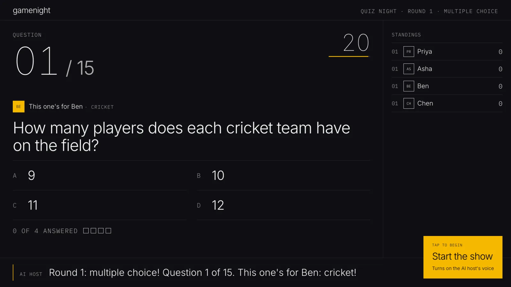
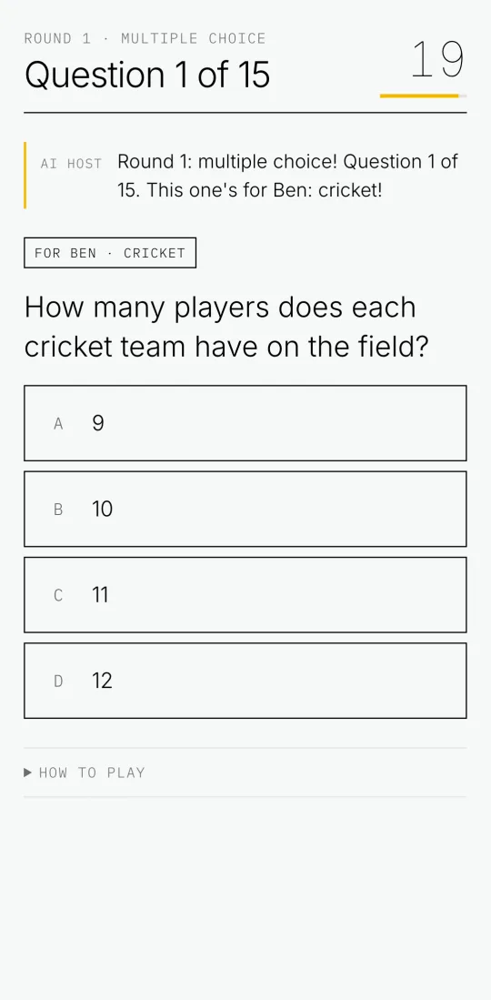
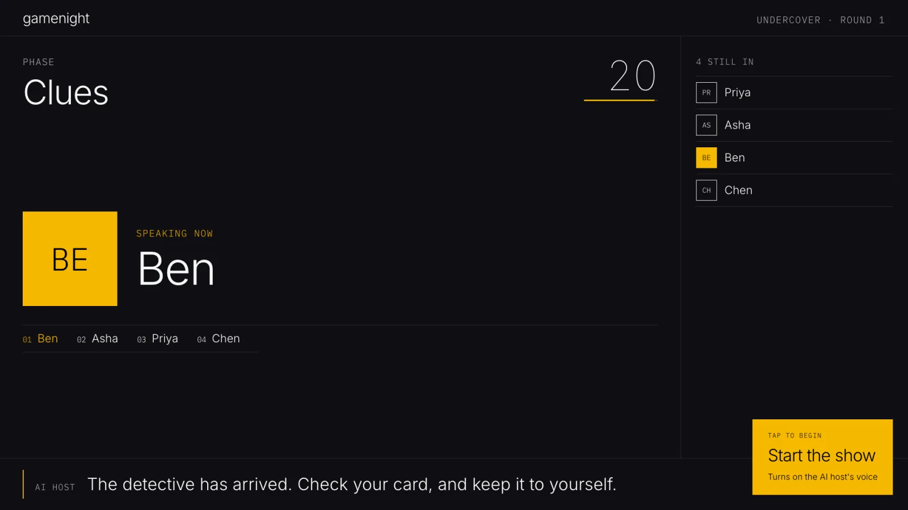
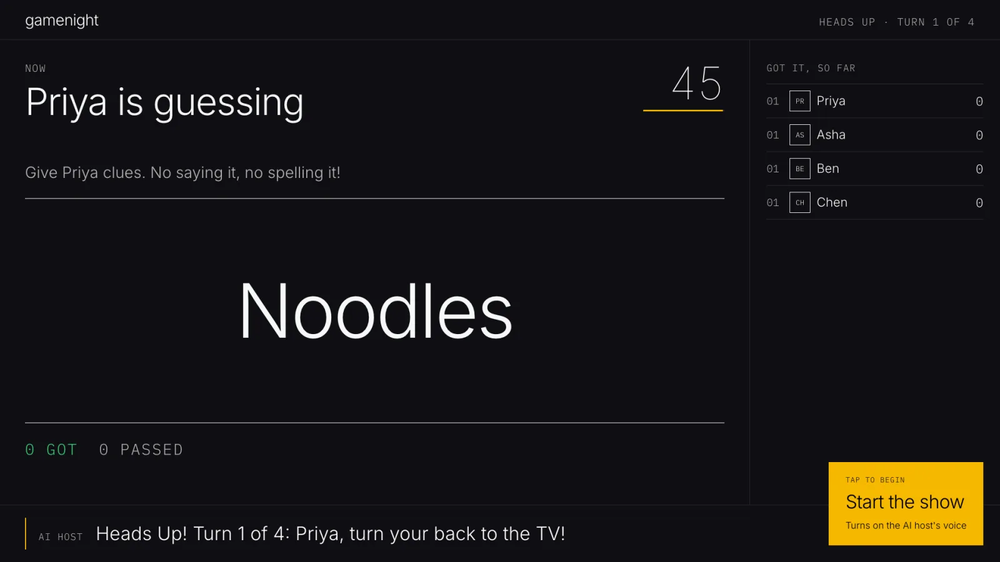
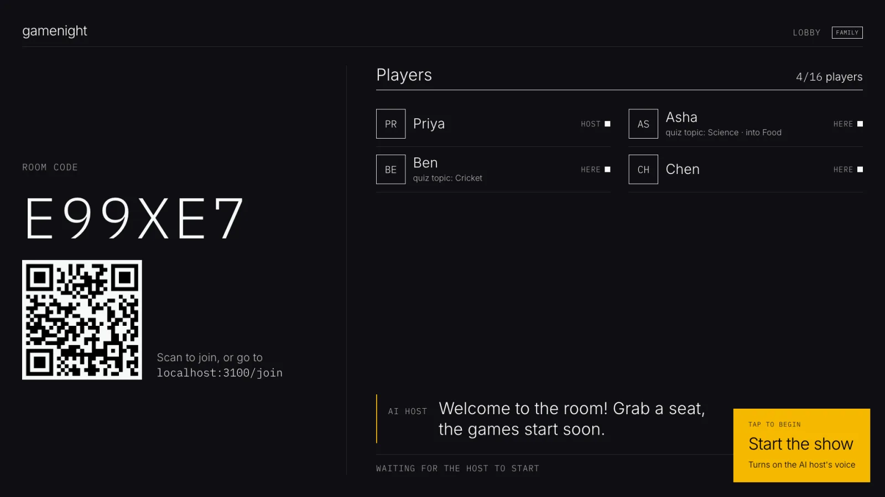
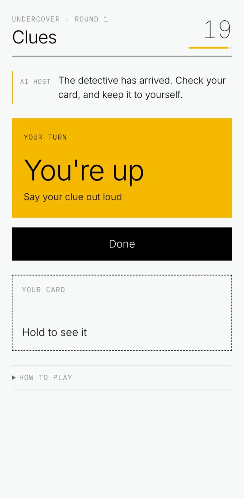
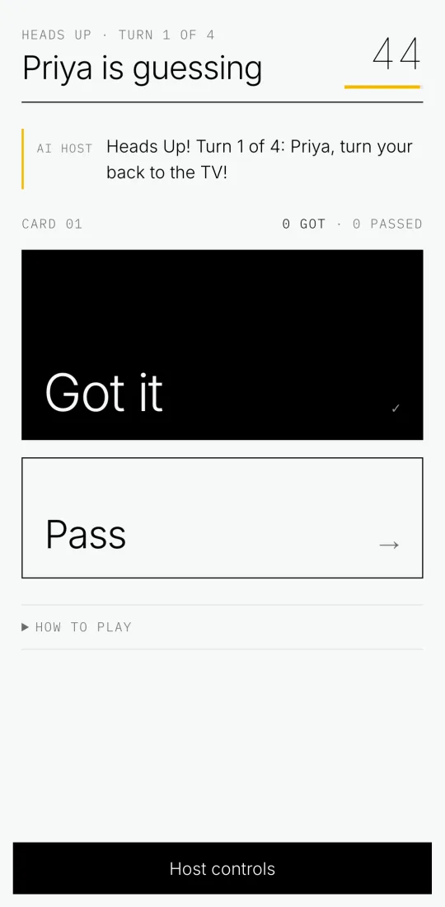
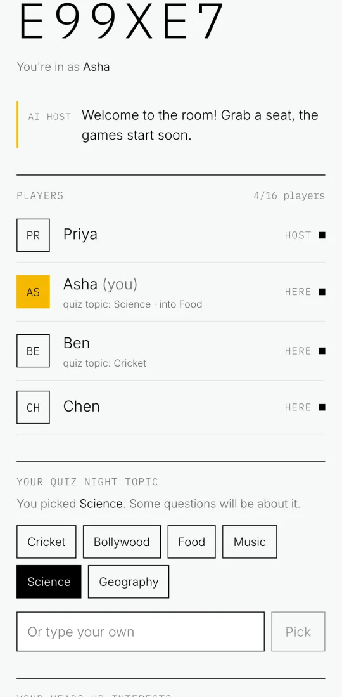
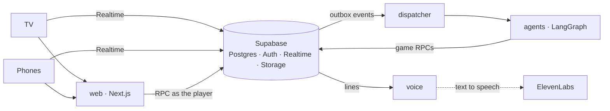

# gamenight

[](https://github.com/lekhanakalyanraj/gamenight/actions/workflows/ci.yml)
[](https://github.com/lekhanakalyanraj/gamenight/actions/workflows/security.yml)
[](https://github.com/lekhanakalyanraj/gamenight/actions/workflows/codeql.yml)
[](https://scorecard.dev/viewer/?uri=github.com/lekhanakalyanraj/gamenight)

Party games for a living room, run by AI. The TV hosts the room, everyone plays on their phone, and AI agents run
the games and narrate them out loud, in a laid-back host's voice. Three games so far: Undercover, Quiz Night and
Heads Up.

<p align="center">
  
  &nbsp;
  
</p>

<table>
  <tr>
    <td width="33%"><br><sub><b>Undercover.</b> Each phone holds a secret word, face down until it's held.</sub></td>
    <td width="33%"><br><sub><b>Heads Up.</b> The card is on the TV only; the guesser's phone never gets it.</sub></td>
    <td width="33%"><br><sub><b>Lobby.</b> Pair the TV by code, join by QR.</sub></td>
  </tr>
  <tr>
    <td align="center"></td>
    <td align="center"></td>
    <td align="center"></td>
  </tr>
</table>

## What's interesting

- **Postgres keeps the secrets.** Words, live answers and cards are guarded by row-level security and per-device
  Realtime topics, not the UI. A simulator plays whole games with bots that try to cheat; any leak fails CI.
- **The AI can't cheat either.** Game masters (LangGraph) act only through validated Postgres functions, once per
  event. Every line the host says is checked in code and by the database before it reaches the TV.
- **AI content is checked against sources.** Players describe what they're into ("90s Bollywood and SRK films"); the
  agents research it on the web, and a question is kept only if code finds its quote on the cited page (forums and
  fan sites refused) and a judge agrees. Brain teasers have no source, so a second model must solve each one blind.
- **The whole quiz is ready before it starts.** Code picks every question of every themed round (brain teasers
  first, connections last), the model writes the host's script in two calls, and then Postgres runs the quiz by
  itself: no model call, and no missing question, during play.
- **One design, every screen.** A teenage-engineering-style design system that scales from a 360 px phone to a 4K
  TV, checked at six widths and against WCAG 2.2 AA with axe in every end-to-end run.
- **Evals gate merges.** Golden cases, leak attacks, narration, quiz accuracy and fun, card review and real-model
  games, on a $10/month budget.
- **Built to run.** Five services, an outbox, one OpenTelemetry trace from tap to model call, Grafana dashboards, a
  load test, Kubernetes with restricted pods, signed images with SBOMs.

## How it works



A tap is an RPC. Postgres checks it, updates the game and writes an event. The dispatcher hands the event to the
AI game master, which moves the game on through its own narrow API and narrates. Screens follow along over
Realtime, and the voice service turns each line into audio.

## Tech stack

| Area | Tools |
|---|---|
| Web | Next.js 16 (App Router), TypeScript, Tailwind CSS 4, Motion |
| Data and realtime | Supabase: Postgres, row-level security, Realtime, Auth, Storage |
| AI | Python, LangGraph Agent Server, LangChain, Claude Haiku 4.5, Tavily web search, LangSmith |
| Voice | ElevenLabs, FastAPI |
| Infra | Docker, Kubernetes (kind), Helm, GitHub Actions, GHCR |
| Observability | OpenTelemetry, Tempo, Prometheus, Loki, Grafana |
| Testing | pgTAP, pytest, Playwright with axe, a game simulator, promptfoo |
| Security | Semgrep, CodeQL, gitleaks, OSV-Scanner, Grype, OWASP ZAP |

## Run it locally

You need Docker, Node 22+ and [uv](https://docs.astral.sh/uv/).

```bash
npm install
cp .env.example .env                           # ANTHROPIC_API_KEY, LANGSMITH_API_KEY; optional: ELEVENLABS_API_KEY
                                               # (voice), TAVILY_API_KEY (web research for quiz questions)
make db-start                                  # local Supabase
cp apps/web/.env.example apps/web/.env.local   # publishable key from `npx supabase status -o env`
GAMENIGHT_MODEL=fake make agents-dev           # free scripted AI; drop the variable for the real model
make dispatcher-dev
make web                                       # http://localhost:3100 (make lan for real phones on your Wi-Fi)
```

Open `/tv` on one screen, sign in as `host@gamenight.test` (password in [supabase/seed.sql](supabase/seed.sql)) on
another, create a room and connect the TV. Players join with the room code.

```bash
make check                        # database, web and service tests
make simulate GAME=quiz           # bots play whole games and hunt for leaks
npm run test:e2e -w @gamenight/web
```

## Repo

```
apps/web/            Next.js: TV, phones, host
services/agents/     LangGraph game masters, narrator, evals
services/dispatcher/ outbox and game timers
services/voice/      lines to audio
supabase/            schema, RLS, game RPCs, pgTAP tests
evals/simulator/     bots, leak probes, load test
infra/               docker-compose, Helm charts, Grafana
```

The full write-up (each game's rules and secrets, the voice pipeline, security checks, observability, Kubernetes,
evals and their latest results) is in [ENGINEERING.md](ENGINEERING.md).

## Licence

[MIT](LICENSE)
